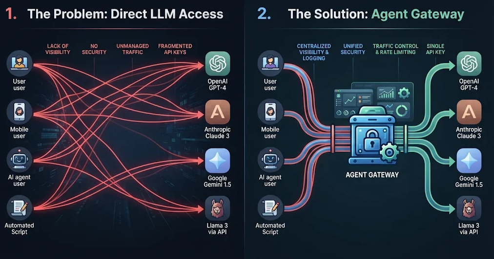

## What is an Agent Gateway?

An **Agent Gateway** is a single entry point that sits between your users/AI agents and the LLM models.

### The Problem
When users and AI agents call LLM models directly:
* **No Visibility:** You cannot easily see who is making requests or how many tokens are being used.
* **No Observability:** It is hard to track errors, slow responses, or agent behavior.
* **Security Risks:** API keys are spread across different apps and agents, making them hard to protect and manage.

### The Solution
An Agent Gateway gives you **one single endpoint** for all LLM requests. From one central place, you get:
* **Centralized API Keys:** Store and manage all your LLM keys safely in one spot.
* **Traffic Control:** Manage rate limits, route requests, and switch models easily.
* **Visibility & Observability:** Monitor usage, costs, logs, and performance in real time.

